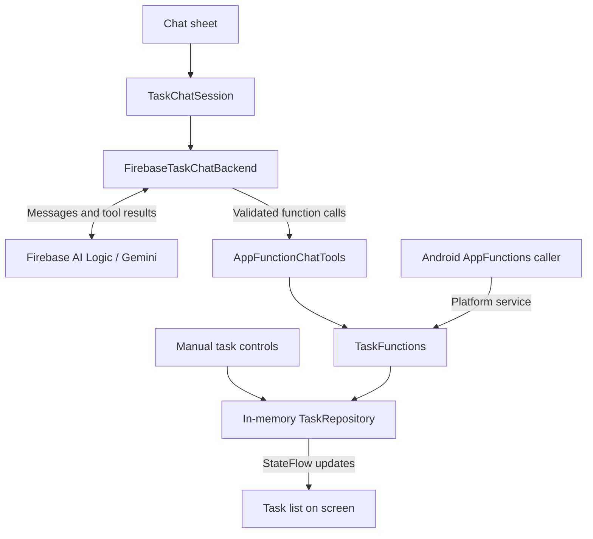

# TaskFlow

TaskFlow is an Android task-manager demo built with Kotlin and Jetpack Compose. Manage tasks through the screen, ask Gemini to manage them through Firebase AI Logic, or expose the same operations through Android AppFunctions.

**Tasks and chat messages are kept only in app memory.** They survive rotation and closing/reopening the chat sheet while the process stays alive, but disappear when Android ends the process or you force-stop the app. There is currently no database or cross-device sync.

## Features

- Create, view, rename, complete, reopen, and delete tasks.
- Use natural-language chat: “Add a task to buy milk” or “Mark Buy milk as completed.”
- Try an optional local command backend without AI requests.
- Explore four Android AppFunctions: `createTask`, `readTasks`, `updateTask`, and `deleteTask`.

There is no sign-in, Firestore, Realtime Database, Cloud Storage, or separately deployed server in this implementation. Firebase supplies AI access and App Check, not task persistence.

## Before you push to GitHub

The root [`.gitignore`](.gitignore) excludes the following:

| Keep out of GitHub | Reason |
| --- | --- |
| `app/google-services.json` and variant copies | Your Firebase project configuration; contributors should use their own project. |
| Service-account JSON, Firebase Admin SDK keys, private keys | Privileged credentials; never embed these in an Android app either. |
| Gemini/provider secret keys, `.env` files, `secrets.properties`, `secrets/` | Private service access. Never hard-code these in Kotlin or Gradle files. |
| App Check debug tokens | Keep tokens out of source, screenshots, issues, and shared Logcat output. |
| Signing keystores and password files | Protect release signing credentials. |
| `local.properties`, `.idea/`, `.gradle/`, `.kotlin/` | Local SDK paths, IDE state, and caches. |
| `build/`, `app/build/`, APKs, bundles, logs, captures | Generated files can contain Firebase configuration or debugging details. |
| `output/`, `tmp/` | Local generated documents and temporary artifacts; review documents separately before publishing. |

Token values are not detected by `.gitignore`: the patterns exclude common files and directories only. A secret pasted into a source file will still be staged.

Commit source and resources, tests, documentation, Gradle build scripts, the version catalog, `gradle.properties` (without secrets), and **all Gradle wrapper files, including `gradle-wrapper.jar`**.

### Firebase configuration versus real secrets

A Firebase client API key identifies the project; it is not an Admin SDK private key. Client configuration is included in the installed app and cannot be secured simply by hiding a file or moving values into environment variables. This repository excludes it so clones do not accidentally use the owner's project.

Protect the service with App Check and appropriate API restrictions. Never add the Gemini Developer API to the allowlist of a publicly exposed Firebase key. If you later add database or storage services, configure their Security Rules and authentication too. See [Firebase API-key guidance](https://firebase.google.com/docs/projects/api-keys).

Ignore patterns do not remove files already committed. Inspect staged changes, including any renamed credential files. If a real secret was committed, revoke/rotate it first, then remove it from Git history; deleting it in a later commit is insufficient. Revoke exposed App Check debug tokens in Firebase. Client configuration alone is not evidence that an admin credential leaked.

## First-time setup

### 1. Install Android tools

Open the repository root in Android Studio. Use a version compatible with the pinned Android Gradle Plugin and SDK rather than downgrading dependencies individually.

| Setting | Current project value |
| --- | --- |
| Android application ID / Firebase package name | `com.appfunctions.taskflow` |
| Kotlin namespace | `com.example.taskflow` |
| Minimum device SDK | API 36 |
| Compile / target SDK | API 37 |
| Android Gradle Plugin | `9.4.1` |
| Gradle wrapper | `9.8.0` |
| Gradle daemon Java toolchain | JDK 25, selected in `gradle/gradle-daemon-jvm.properties` |
| Java source / target compatibility | Java 11; distinct from the Gradle daemon JDK |

Install Android SDK Platform 37 and an emulator image for API 36 or newer through SDK Manager. Platform AppFunctions tests also need a device image that provides the AppFunctions system service. The first sync needs internet access for dependencies and potentially the configured JDK toolchain.

Android Studio normally creates `local.properties` with your SDK location. Keep it local; do not commit your machine's SDK path.

### 2. Create and connect your own Firebase project

1. Open the [Firebase console](https://console.firebase.google.com/) and create a project. Google Analytics is optional for this app.
2. Register an **Android app** with package name **`com.appfunctions.taskflow`**. Do not use the Kotlin namespace `com.example.taskflow`.
3. Download `google-services.json` and place it at **`app/google-services.json`**, beside `app/build.gradle.kts`. Do not rename it or put it in the repository root.
4. Open **AI Logic** and complete **Get started**. Select **Gemini Developer API**, matching `GenerativeBackend.googleAI()` in this app. Finish enabling the required APIs and resources.
5. For no-cost experimentation, use an eligible model with the Spark plan. Read the billing notes below before linking a billing account.

The Google Services plugin, Firebase dependencies, and internet permission are already included. Do not paste a Gemini Developer API secret into the app: Firebase AI Logic handles that connection. See the [official Android setup guide](https://firebase.google.com/docs/ai-logic/get-started?platform=android).

### 3. Register App Check for development

`TaskFlowApplication` selects the debug App Check provider for debuggable builds and Play Integrity for non-debug builds. Current Firebase AI Logic setup can enforce App Check automatically, so complete this step for emulator testing too.

1. Build and run the **debug** app, open Chat, and send “Show tasks.” The initial request may fail before registration.
2. In Android Studio Logcat, filter for `DebugAppCheckProvider` and find the generated debug token. Keep it private.
3. In Firebase **App Check**, select your Android app, open its overflow menu, choose **Manage debug tokens**, and register the token.
4. Retry after registration; restart the app if necessary. A new emulator or cleared app data may need another token.

See the [Android debug-provider instructions](https://firebase.google.com/docs/app-check/android/debug-provider). Do not disable enforcement as a permanent workaround.

### 4. Build and launch

Sync Gradle, select the `app` run configuration and an API 36+ device, then click **Run** in Android Studio.

Alternatively, from the repository root on macOS/Linux:

```sh
./gradlew :app:assembleDebug
./gradlew :app:installDebug
```

`installDebug` needs a connected device or running emulator. Open TaskFlow from its launcher icon after installation. On Windows, use `gradlew.bat` instead of `./gradlew`. If the wrapper is not executable, run `chmod +x gradlew` once.

The debug APK is generated at `app/build/outputs/apk/debug/app-debug.apk`. Keep generated APKs out of source commits.

### 5. Check the app

1. Add a task manually and change its completion status.
2. Open Chat and ask “Show my tasks.” Verify the reply matches the screen.
3. Ask “Add a task named Model check.” Confirm one task appears.
4. Ask to rename, complete, reopen, and finally delete that test task. Check the screen after each operation.
5. If chat fails after an action, inspect the task list before resending: the action may have succeeded even if the final AI reply failed.

Manual task controls do not need an AI response. The configured build still needs Firebase configuration.

## Models, free-tier limits, and trying alternatives

The current model is `gemini-3.6-flash`, configured in [`FirebaseTaskChatBackend.kt`](app/src/main/java/com/example/taskflow/chat/FirebaseTaskChatBackend.kt). There is no in-app model picker or automatic fallback.

Candidates to try, based on Firebase's model catalog checked on **2026-10-19**:

| Model ID | Use here |
| --- | --- |
| `gemini-3.6-flash` | Existing app default. |
| `gemini-3.8-flash` | Alternative stable Flash model. |
| `gemini-3.5-flash-lite` | Alternative lightweight model for simple task commands. |

Firebase lists these families as available without billing through the Gemini Developer API. Access, quotas, and retirement dates can change; check the [supported-model catalog](https://firebase.google.com/docs/ai-logic/models?api=dev). Choose a text model supporting function calling, not an image, audio, or Live API model.

To try an alternative, change only `modelName` in the existing `generativeModel(...)` call, keeping the tools and system instruction:

```kotlin
modelName = "gemini-3.5-flash-lite",
```

Rebuild and restart, then repeat the five app checks above with disposable tasks. Restarting clears tasks and chat. Test one model at a time and compare actual task changes, not just conversational replies. **These are documentation-verified candidates, not a claim that live requests to each model were tested with your Firebase project.**

**Some free-tier models may fail temporarily because of high demand, exhausted quotas, or service problems.** Other causes include model availability, billing eligibility, API setup, and App Check. A failed request does not automatically mean the app is broken or every model will fail. Try another eligible model, reduce request frequency, or wait for quota/capacity to recover. Switching models does not bypass project-wide limits. See [Firebase AI error guidance](https://firebase.google.com/docs/ai-logic/error-codes).

“Free tier” is not unlimited usage or guaranteed availability. Firebase AI Logic itself has no separate usage charge, but model usage depends on the provider and project plan. Linking Cloud Billing moves the project to Blaze and Gemini Developer API usage becomes pay-as-you-go. Review [AI Logic pricing](https://firebase.google.com/docs/ai-logic/pricing) and your console before enabling billing. Budget alerts are notifications, not a hard spending cap.

## How it works



1. `TaskFlowApplication` owns one shared repository and chat session for the app process.
2. Manual controls update the repository directly. Compose observes its `StateFlow`, so changes appear in the list.
3. The chat session stores messages, shows loading/errors, and allows one request at a time.
4. The Firebase backend creates a model conversation from earlier user/assistant text, excluding the welcome message and error messages, then sends the newest message.
5. Gemini can request a declared function. The backend validates argument types and dispatches locally through `AppFunctionChatTools` to `TaskFunctions`.
6. The actual result or a structured error is sent back to the model. It can reply or request another function. The backend permits eight function-call rounds per message; a round can contain multiple calls.

The AI does not execute arbitrary Kotlin or directly write to Firebase storage. Task mutations run in the Android app. In-app chat calls the function implementation directly without routing through Android's system service. Separately, AppFunctions annotations, KSP-generated metadata, and the manifest service expose those operations through the platform. External assistant support depends on the assistant, OS, and permissions; installing this sample does not guarantee assistant integration.

| Function | Inputs | Result |
| --- | --- | --- |
| `createTask` | Nonblank `title` | Task with UUID, title, and `completed = false` |
| `readTasks` | None | Current tasks including IDs |
| `updateTask` | `id`; optional `title` and `completed`, with at least one supplied | Updated task; omitted fields stay unchanged |
| `deleteTask` | Existing task `id` | `true` after deletion |

Titles are trimmed and cannot be blank. Missing IDs and invalid updates produce errors. The model is instructed to read tasks before resolving names, clarify ambiguous names, and mutate only when requested. These are model instructions, not a separate confirmation screen or authorization system. A tool call changes a task immediately; several actions in a turn are not an atomic transaction.

Chat text and task details returned by tools are sent to the cloud AI service. Local task storage does not mean AI processing is offline. Use sample data when experimenting and review the provider's data-use terms before sending sensitive information. History grows for the lifetime of the process; there is no history trimming or persistent conversation storage.

## Optional local command mode

For task demos without AI requests, import `com.example.taskflow.chat.LocalTaskChatBackend` in `TaskFlowApplication.kt` and replace:

```kotlin
backend = FirebaseTaskChatBackend(),
```

with:

```kotlin
backend = LocalTaskChatBackend(),
```

Rebuild and restart. Try these commands:

```text
Add Buy milk
Show tasks
Complete Buy milk
Reopen Buy milk
Rename Buy milk to Buy oat milk
Delete Buy oat milk
```

Commands accept an ID or an exact, case-insensitive title; duplicate titles require an ID. This mode parses commands locally and does not understand general natural language. It is a manual choice, not automatic fallback after Firebase errors. Firebase dependencies, startup App Check initialization, and the Google Services build plugin remain, so this simple switch still requires `app/google-services.json`.

## Troubleshooting

| Symptom | What to check |
| --- | --- |
| `google-services.json` missing | Download your configuration into `app/`. It is deliberately excluded from Git. |
| No matching client for package name | Register `com.appfunctions.taskflow` and download the matching file. |
| Gradle sync / Java / SDK failure | Check JDK 25, SDK 37, Android Studio compatibility, internet access, and pinned versions. |
| App Check / attestation / permission error | Check the project, enabled APIs, key restrictions, debug-token registration, and provider. |
| Model not found / unsupported | Verify the exact ID and availability for the Gemini Developer API. |
| `429` / quota exhausted | Check quotas, traffic, and model/plan eligibility; wait or try an eligible alternative. |
| `503` / unavailable / overloaded | Wait, or try another available model. See [Gemini troubleshooting](https://ai.google.dev/gemini-api/docs/troubleshooting). |
| Network error / timeout | Check connectivity; inspect the task list before retrying an action. |
| Chat failed but a task changed | Tool execution and the final reply are separate; avoid blindly repeating a mutation. |
| Action-limit message | Inspect completed changes and split remaining work into smaller requests. |
| Tasks disappear after restart | Expected: tasks are in memory only. |
| AppFunctions test fails | Use a supported image, check service availability, and allow Android time to index the app. |

Use “Show tasks” when diagnosing connectivity rather than repeatedly resending create/delete requests. The app displays errors but has no automatic retry, model switching, or rollback.

## Tests

After completing local configuration:

```sh
./gradlew :app:testDebugUnitTest :app:lintDebug
```

Chat unit tests cover local create/read/update/delete commands, ambiguity handling, invalid input, and duplicate-send prevention. They do not validate live Firebase credentials, model availability, or AI behavior.

With a compatible device/emulator connected:

```sh
./gradlew :app:connectedDebugAndroidTest
```

The AppFunctions integration test exercises create/read/update/delete through Android's system service. Use a test device and disposable data. Reports under `app/build/` are excluded from Git.

## Publishing the repository

Create an empty repository on GitHub. If this folder is not already a Git repository:

```sh
git init
git branch -M main
```

Verify exclusions and review what will be published:

```sh
git check-ignore -v app/google-services.json local.properties
git add .
git status --short
git diff --cached --stat
git diff --cached
```

The configuration and local-property files should be ignored and absent from staged changes. If either was previously tracked, use `git rm --cached -- app/google-services.json` or `git rm --cached -- local.properties` as applicable to remove it from the index while keeping the local file. This does not remove older history.

After review, replace `YOUR_USERNAME` and `YOUR_REPOSITORY` with your GitHub details:

```sh
git commit -m "Add TaskFlow Android demo and setup documentation"
git remote add origin https://github.com/YOUR_USERNAME/YOUR_REPOSITORY.git
git push -u origin main
```

If a remote exists, inspect `git remote -v` instead of adding it again. Do not force-push to resolve an existing repository's history. Website uploads do not apply your local `.gitignore`; prefer Git and inspect the file list.

For CI builds, supply Firebase configuration and required tokens through the CI secret store. Do not put credential values in workflow YAML or print them to logs.

## Before distributing a release build

Register the production App Check provider, **Play Integrity**, and configure the release signing certificate's SHA-256 fingerprint. The code selects this provider for non-debug builds. Follow [Firebase's Play Integrity setup](https://firebase.google.com/docs/app-check/android/play-integrity-provider), including requirements for your distribution channel. Debug-token registration does not authorize a release build.

Configure release signing privately, confirm API restrictions and quotas, and validate chat on the signed build. Add durable storage if users should keep their tasks. This demo has no release-signing setup, persistent data layer, or automatic recovery from partially completed AI turns.

## Project guide

| Path | Purpose |
| --- | --- |
| `app/src/main/java/com/example/taskflow/MainActivity.kt` | Compose task interface |
| `app/src/main/java/com/example/taskflow/TaskFlowApplication.kt` | Shared state, backend choice, App Check, AppFunctions configuration |
| `app/src/main/java/com/example/taskflow/data/` | Task model and in-memory repository |
| `app/src/main/java/com/example/taskflow/appfunctions/` | Annotated task operations |
| `app/src/main/java/com/example/taskflow/chat/` | Chat UI, session, local/Firebase backends, tool adapter |
| `app/src/test/` and `app/src/androidTest/` | Unit and device tests |
| `gradle/libs.versions.toml` | Dependency versions |
| [docs/firebase-chat.md](docs/firebase-chat.md) | Backend implementation notes |
